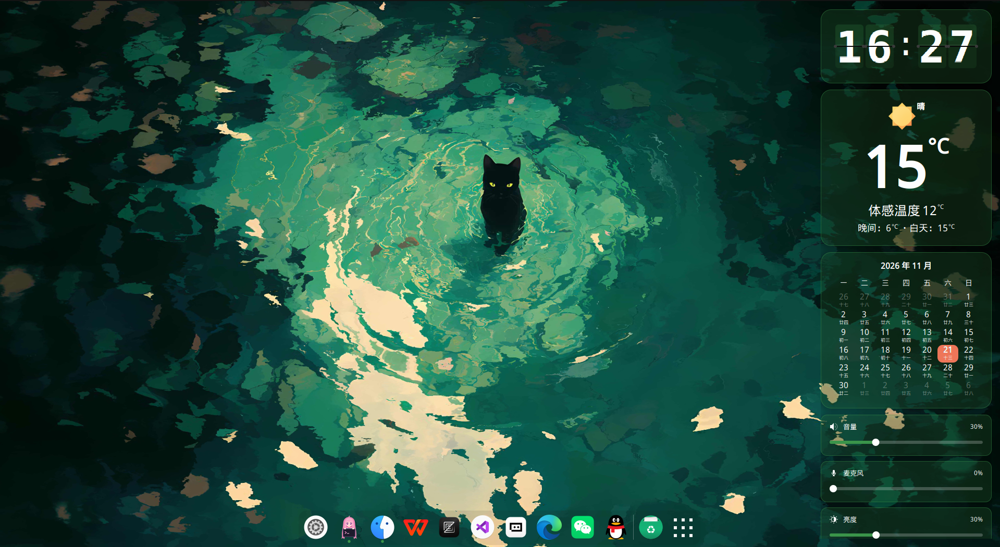

# NextSidebar



GNOME Shell 51 侧栏，默认从右侧滑出，可在设置里改为左侧；自上而下是翻页时钟、天气卡、月历卡，以及音量 / 麦克风 / 亮度滑块。外壳透明露出桌面壁纸，卡片与滑块格用强调色半透明玻璃底。天气数据来自小米天气。`Super+\` 或所设置一侧边缘中部的悬停开合侧栏。

## 功能

- **翻页时钟**：`HH:MM` 四位 24 小时制，用 Clutter actor 属性实现上下半片依次翻转的 3D 翻页；数字中心落在中缝，翻页片静止时隐藏、无中缝残影。不显示秒与 AM/PM。
- **天气卡**：当前温度、体感、当天高低温与彩色天气图标。城市可切换，见「设置」。
- **月历**：周一起始，公历数字下方一行小字，今天橙色高亮，非本月日期淡化；年月标题在卡片内水平居中，星期行与日期网格整体居中。第二行小字按 **节日 > 节气 > 农历日** 的优先级显示，节日清单见下表。
- **滑块**：音量、麦克风、亮度三段，跟随强调色；检测不到麦克风或屏幕背光时对应滑块自动隐藏或显示 N/A。
- **玻璃观感**：外壳透明露出壁纸；卡片与滑块格用 18% 强调色半透明底 + 1px 细边框 + 柔和阴影近似玻璃质感（St 的 CSS 引擎不支持背景模糊，无法做真毛玻璃）。滚动条外观隐藏，但滚轮仍可滚动到底。

### 月历节日清单

| 类型 | 节日 |
|------|------|
| 公历固定 | 元旦、妇女节、植树节、劳动节、青年节、儿童节、建党节、建军节、教师节、国庆 |
| 农历固定 | 春节、元宵、端午、七夕、中秋、重阳 |
| 农历变日 | 除夕（腊月最后一天）、清明（节气同名） |

## 使用

- 按 `Super+\` 开合侧栏；侧栏外点击可收起。
- 鼠标滑到所设置一侧屏幕边缘的中间 1/3（默认右侧；顶栏下方可用高度的上、下各 1/3 不触发）、停留约 250ms，侧栏自动弹出；已打开时再碰边缘不会打断。
- 鼠标离开侧栏后 5 秒自动收起，期间移回侧栏则取消收起继续操作。

## 设置

```bash
gnome-extensions prefs nextsidebar@github.com
```

设置窗口分「侧边栏位置」与「城市」两组。侧边栏位置用「滑出方向」下拉在右侧（`right`，默认）与左侧（`left`）之间切换，改完即时生效，侧栏立即换到所选边缘。城市组：手工输入任意城市名，或从快捷表选择。快捷表是 `src/cities.js` 的预设城市加上搜索成功过的自定义城市（带归属地副标题，避免重名混淆）；手输城市搜索成功后会自动存进 `custom-cities`，下次直接可选。

城市同时决定时钟时区：预设城市用 IANA 时区（自动处理夏令时），自定义城市用小米搜索返回的 `timeZoneShift` 构造固定偏移，并每 15 分钟随天气刷新。改完设置即时生效，无需重新登录。

## 数据

默认城市为苏州，由设置的 `city` 决定。

- **位置查询**：按城市名调用小米天气 `location/city/search`，查出坐标、`locationKey` 与 `timeZoneShift`；预设城市按城市名缓存位置，自定义城市每次重搜以刷新夏令时偏移。
- **天气拉取**：每 15 分钟用坐标 + `locationKey` 调 `weather/all`，拉取当前温度、体感、天气码与当天高低温。
- **字段取值**：当前 / 体感温度取 `current.temperature.value` / `current.feelsLike.value`；白天最高 / 夜间最低取 `forecastDaily.temperature.value[0]` 的 `from` / `to`；昼夜由观测时间 `pubTime` 的小时判断。

天气依赖联网访问小米天气接口；接口变更或不可达时天气卡数据会失效，其余卡片与滑块不受影响。

## 安装与启用

仅支持 GNOME Shell 51（`metadata.json` 的 `shell-version` 为 `["51"]`），其他版本需改此字段并自行验证兼容性。GNOME Shell 只在启动时扫描扩展目录，新扩展需要重新登录才会出现在列表里。

安装或升级直接执行（升级会覆盖旧文件）：

```bash
./install.sh
```

重新登录后启用，并可打开设置窗口：

```bash
gnome-extensions enable nextsidebar@github.com
gnome-extensions prefs nextsidebar@github.com
```

卸载：先停用，再删除扩展目录。

```bash
gnome-extensions disable nextsidebar@github.com
rm -rf ~/.local/share/gnome-shell/extensions/nextsidebar@github.com
```

## 许可证

本扩展以 GPL-3.0 发布，见 `LICENSE`。天气图标来自 Breezy Weather（LGPL-3.0），来源与归属见 `icons/SOURCES.md`。

## 文件

- `extension.js`：扩展入口，侧栏挂载、三卡 UI、设置接线、快捷键与主题重挂。
- `prefs.js`：GNOME 扩展设置窗口（GTK4 + libadwaita），侧边栏位置与城市设置。
- `stylesheet.css`：卡片玻璃底、侧栏外壳、滑块与日历样式。
- `install.sh`：安装脚本，复制运行必需文件到用户扩展目录并编译 schema。
- `src/sidebar.js`：按设置从左 / 右边缘滑出的侧栏容器（chrome 挂载、滑入动画、滚动内容区、对应边缘中段触发条、离开自动收起）。
- `src/sidebar-geometry.js`：位置归一化、主显示器几何获取（layoutManager → Meta.Display → 兜底）与中段触发条计算，不依赖 Shell 运行时。
- `tests/`：纯逻辑回归测试（`node --test`），不进入 EGO 包。
- `src/flip-clock.js` / `src/flip-clock-digits.js`：翻页时钟的 St/Clutter 组件与纯数字决策。
- `src/sliders.js`：音量 / 麦克风 / 亮度滑块与 Gvc 接线。
- `src/hover-trigger.js`：悬停状态机（边缘停留弹出、离开延时收起、移回取消），不依赖 Shell 运行时。
- `src/cities.js` / `custom-cities.js` / `timezone.js`：城市表、自定义城市持久化与城市到时区的解析，扩展和设置窗口共用。
- `src/weather-service.js` / `weather-icons.js` / `weather-theme.js` / `weather-gradient.js`：天气请求与解析、图标映射、昼夜配色；`weather-gradient.js` 已不再接入扩展，仅供测试。
- `src/calendar-grid.js` / `lunar-date.js` / `solar-term.js` / `holiday.js` / `clock-math.js` / `layout.js` / `extension-paths.js`：日历网格、农历换算、节气换算、节日匹配、时钟数学、布局与资源路径解析等纯逻辑。
- `icons/`：Breezy Weather 彩色天气 PNG，来源固定在 `icons/SOURCES.md`。
- `schemas/`：GSettings schema，安装时编译为 `gschemas.compiled`。
